<div align="center">

# Home School TV

**Lessons on the family TV. Tests on each child's own device. A calm pad for the parent.**

A home-school learning app for children aged 10 to 12, built and used by one family.

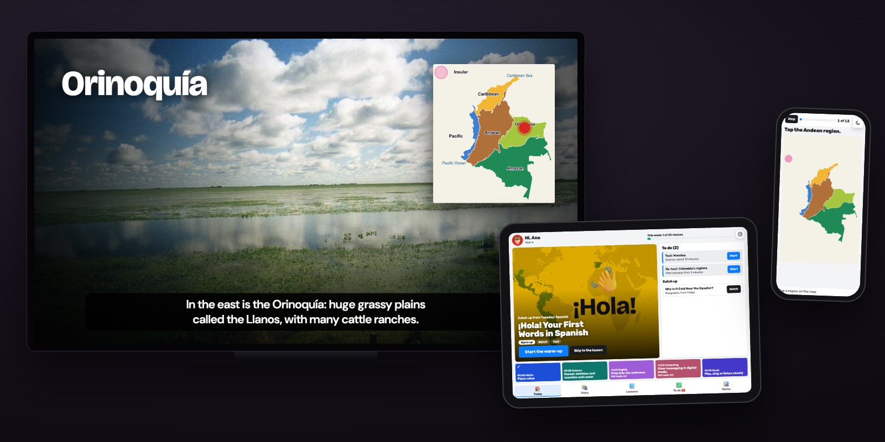

</div>

> **Status: a family prototype.** It runs on one computer at home and is used every day by one family. It is not a finished product for other families yet: sign-in is only checked in the browser, passwords are stored as plain text, and it is meant for a home Wi-Fi you trust. See [What works today](#what-works-today) and [SECURITY.md](SECURITY.md).

## How it works

The family watches a lesson together on the TV. Then each child signs in on their own tablet or phone, where the test is already waiting. The parent follows the day from a pad, prints what's needed, and starts exams.

### 1. A lesson on the TV
Short animated lessons with a recorded voice, subtitles, real photos and a few trimmed video clips. The TV remote works: OK pauses, left and right skip 10 seconds, down shows the controls and chapters.

<p align="center">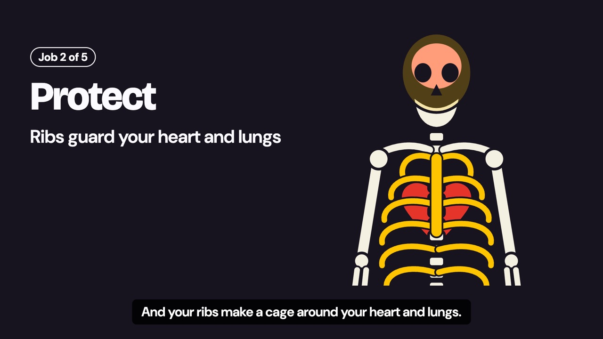</p>

<p align="center">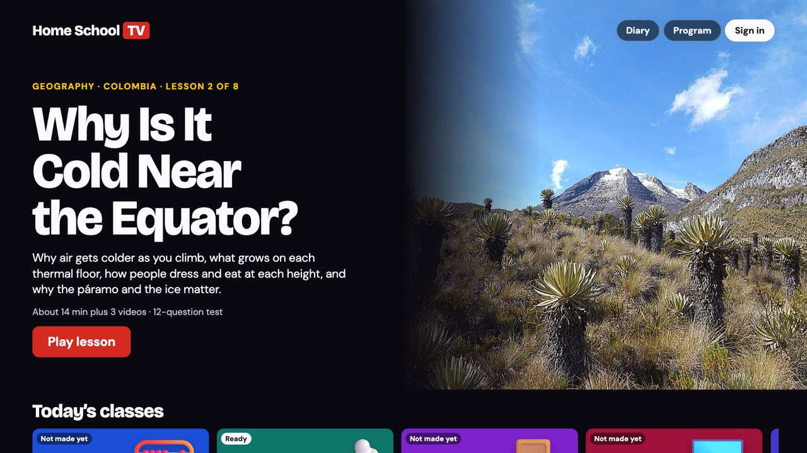</p>

### 2. The child's day, on a tablet
One sign-in, then **Today**: the next lesson, tests to do and lessons to catch up. Tabs for **Diary**, **Lessons**, **To do** and **Marks**. Each child picks one of 14 looks.

<p align="center">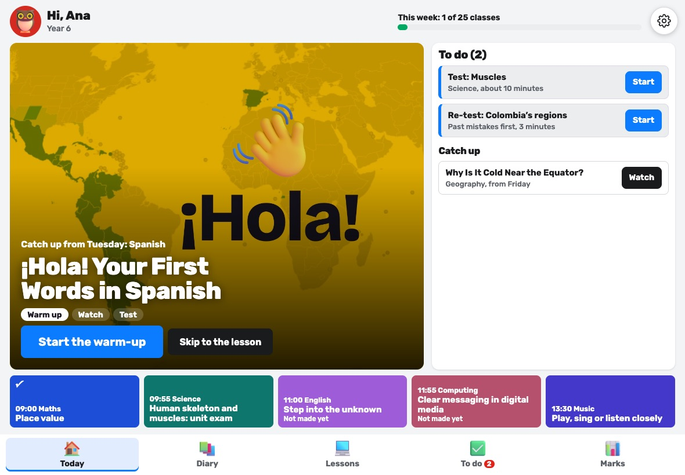</p>

### 3. A test on a phone
Tests arrive by themselves after a lesson. 19 kinds of question: tap a region on a map, sort, match, put in order, listen, fill gaps, write. Mistakes come back as re-tests after 1, 7 and 30 days.

<p align="center">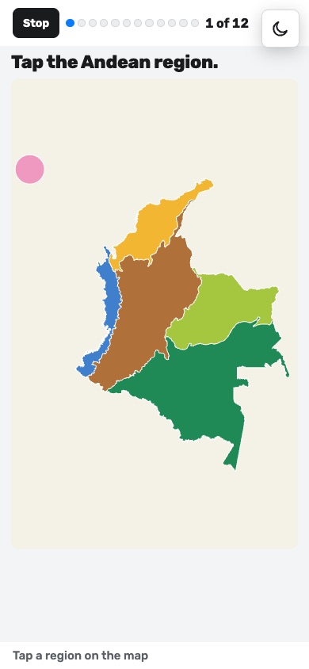</p>

### 4. The parent pad: Today
The parent's home screen. It has one job: put today's lesson on the TV. Other lessons wait on the right. A bottom bar leads to **Children**, **Materials**, **The week** and **The program**. Text size is adjustable for parents who need it larger.

<p align="center">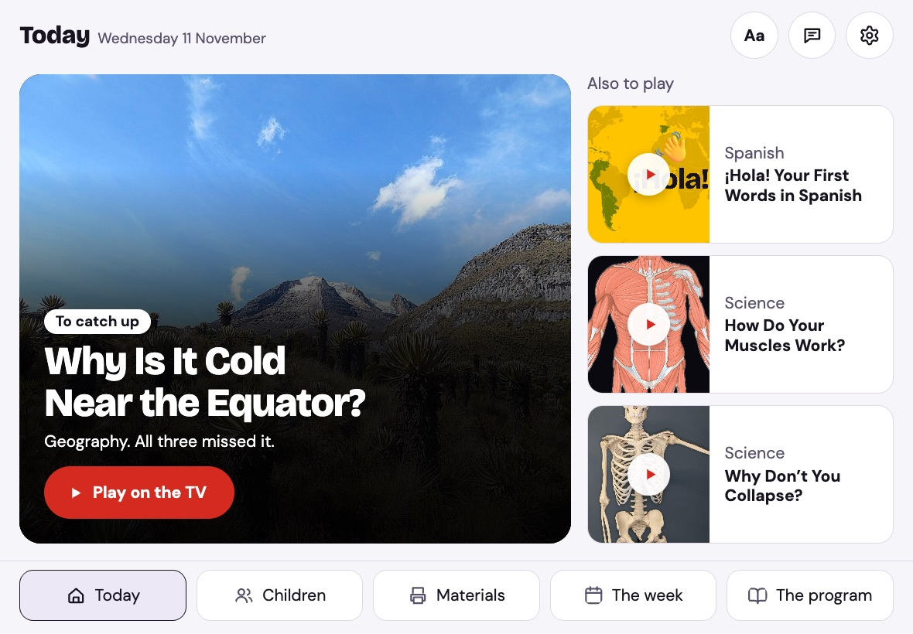</p>

### 5. Materials to print
Worksheets made from the week's lessons, each child's week, habit charts and exam papers. They print on A4 in black and white, with nothing of the app around them.

<p align="center">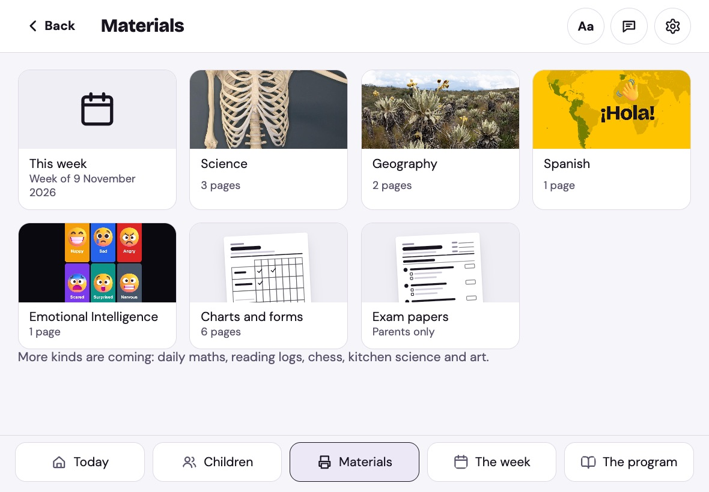</p>

### 6. The diary and the week
Each child has a school diary for the week: subjects, topics, homework and marks. The parent sees every child's week on one screen and signs it.

<p align="center">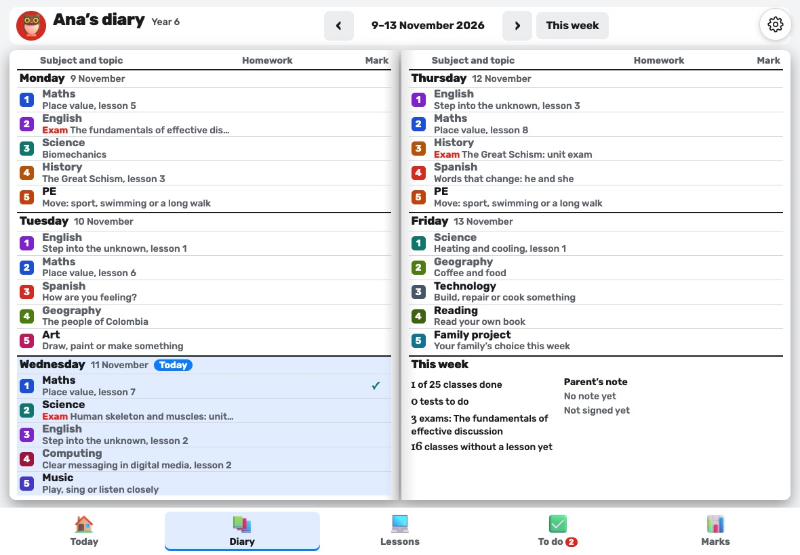</p>
<p align="center">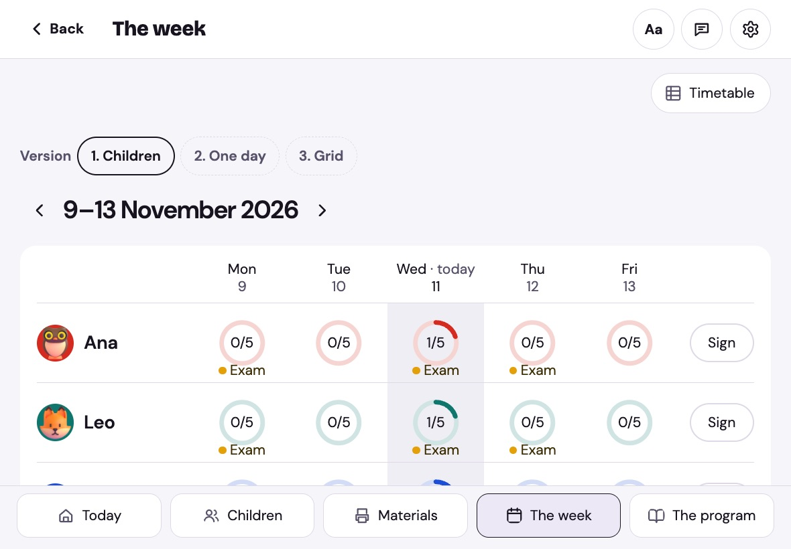</p>

### 7. The exam
A timed unit exam that a parent starts with a PIN. It marks itself. For written answers, the child compares their own words with the model answer, point by point. Nothing waits for a parent to mark.

<p align="center">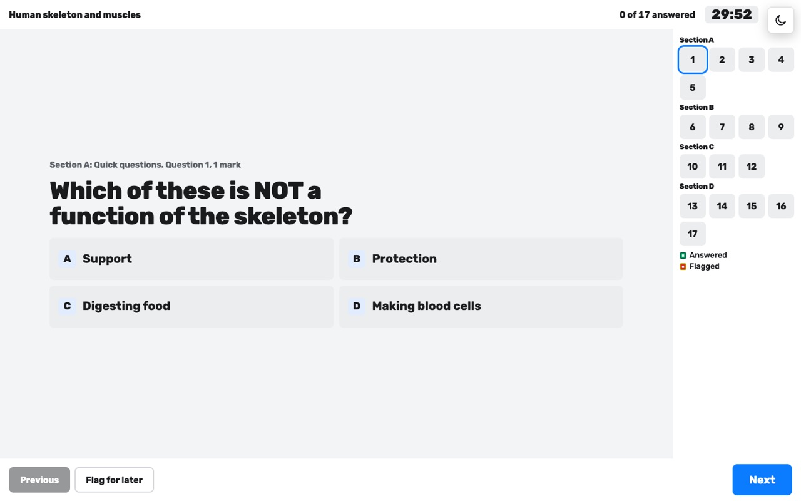</p>
<p align="center">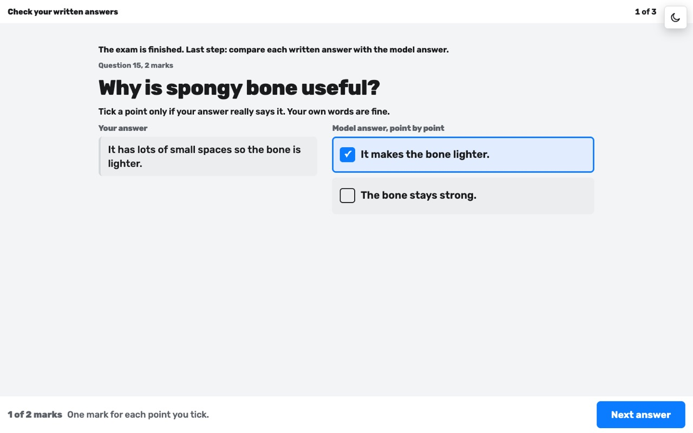</p>

## What works today

| Part | Works today | Not yet |
|---|---|---|
| **TV lessons** | 7 lessons with voice, subtitles, photos, video clips and remote control. All 7 pass the automatic lesson check | Two (Emotional Intelligence and the brain lesson) are still waiting for a person to watch them through |
| **Child's app** | Sign-in, Today, Diary, Lessons, To do, Marks, settings, 14 looks | Not tried on every real tablet |
| **Tests and exams** | 19 question types, starter quiz, lesson test, fix my mistakes, re-tests, one unit exam | One exam so far |
| **School year** | Timetable, diary, a learning map and a program document that prints | Term reports |
| **Parent pad** | Today, Children, Materials, The week, The program, Admin, text size | Two parents with different roles |
| **Data** | One JSON file on the home computer, shared over Wi-Fi | A real database and server-checked accounts |

**The lessons:**

| Subject | Lesson |
|---|---|
| Science | Why Don't You Collapse? (the skeleton) |
| Science | How Do Your Muscles Work? |
| Geography | Colombia: One Country, Six Regions |
| Geography | Why Is It Cold Near the Equator? |
| Spanish | ¡Hola! Your First Words in Spanish |
| Emotional Intelligence | What Are Emotions For? |
| Science (bonus) | How Your Brain Talks to Your Body |

Lessons follow England's National Curriculum where it applies; anything outside it is marked as a bonus. That means "follows", not "approved": nobody has accredited this program.

### Honest limits
- **Sign-in is checked only in the browser.** The server doesn't know who is asking. Anyone on the same Wi-Fi can read or change the family data.
- **Passwords and PINs are stored as plain text,** and the example logins are in the code.
- **Home Wi-Fi only.** Don't put it on the internet.
- **No backup** unless you set one up. (The family's own server Mac has a nightly backup script in `tools/host/`.)
- **Video clips come from YouTube,** for family use. Its terms bar charging for embedded videos, so a paid service would need another route.
- **Add to Home Screen** makes it open like an app on an iPad, but it still needs the home computer and the Wi-Fi.

### Planned
Server-checked sign-in with protected passwords, a real database, two parents with their own roles, a phone as the TV remote, simple downloads for Windows, Mac and Linux, and later a paid service charged per child. The plan is in [the roadmap](docs/product/ROADMAP.md) and [the release plan](docs/product/RELEASE-PLAN.md).

## Quick start

You need [Node.js](https://nodejs.org) 22 or newer. Nothing else: the voices and pictures come with the project.

```bash
git clone https://github.com/zetwin/homeschool-tv.git
```
```bash
cd homeschool-tv
```
```bash
npm start
```

Open http://localhost:8080. A TV or tablet on the same Wi-Fi can open the address the server prints. Example logins are under **Test accounts** on the sign-in page. Keep the Terminal window open: closing it stops the server.

More: [the setup guide](docs/SETUP.md).

## Make your own lessons

The lessons are written with [Claude Code](https://claude.com/claude-code), following written rules and checked by helpers, so a new lesson can reach the same quality as the existing ones.

1. Install Claude Code (it needs a paid Claude plan) and open it in this folder. It reads [`CLAUDE.md`](CLAUDE.md) first.
2. Ask for a lesson in plain words, for example: *"Make Science lesson 3 of the skeleton and muscles unit: Movement."*
3. Claude follows [the 12 lesson steps](docs/rules/LESSON-RULES.md): it places the lesson in the official program, collects facts with sources, writes the script, finds licensed pictures and video clips, records the voice, and runs the checks. Seven helpers in [`.claude/agents/`](.claude/agents/) do the research, fact-checking, licence checks, a first look as a child, and the TV test.
4. **You watch the whole lesson and every clip, and listen to the voice.** Claude can't see video or hear sound, so that last check is always a person's.

What makes the quality is written down: [quality notes](docs/rules/QUALITY-NOTES.md) (mistakes made and what worked), [lesson rules](docs/rules/LESSON-RULES.md), [content rules](docs/rules/CONTENT-RULES.md), [video rules](docs/rules/VIDEO-RULES.md) and [test rules](docs/rules/TEST-AND-EXAM-RULES.md). Recording voices needs about 500 MB more (`npm run voice:setup`), and Spanish voices need Python 3.12 ([setup guide](docs/SETUP.md)).

## Requirements

| What | Why |
|---|---|
| A computer with Node.js 22 or newer | Runs the server. Mac, Windows or Linux. It must stay on during school |
| A TV with a web browser, or a laptop plugged into the TV | Shows the lessons |
| A tablet or phone per child | Tests, diary and the child's day |
| One home Wi-Fi for all of them | Everything talks to the home computer |
| About 100 MB of disk | Mostly pictures and recorded voices |
| Optional: about 500 MB more | Only to record new voices (`npm run voice:setup`) |

## Project map

| Folder | What it is |
|---|---|
| [`channel/`](channel/) | **The app.** Plain HTML, CSS and JavaScript, with no build step. `app.js` is the TV and the lesson player; `views/` holds the child's app, tests, exams, the parent pad, the diary and Materials |
| [`channel/episodes/`](channel/episodes/) | One file per lesson: script, scenes, test |
| [`channel/assets/`](channel/assets/) | Pictures (with [credits](channel/assets/img/credits.json)), icons and recorded voices |
| `channel/pad-lab/`, `kid-lab/`, `materials-lab/`, `children-lab/`, `theme-kit/` | **Design labs.** Clickable design rounds, not the app. See [the design gallery](docs/DESIGN-GALLERY.md) |
| `channel/round1/`, `test-styles/`, `game/`, `layouts/`, `style-references/` | Older or rejected experiments, kept as a record |
| [`tools/`](tools/) | The server (`serve.mjs`), checks, voice recording, picture fetching, the home-server scripts |
| [`CLAUDE.md`](CLAUDE.md), [`.claude/agents/`](.claude/agents/) | How Claude Code works on this project, and the seven helpers that make and check lessons |
| [`docs/`](docs/) | Product plans, rules for lessons, tests and screens, research with sources. Start at [docs/README.md](docs/README.md) |
| [`prototype/`](prototype/) | The very first prototype, kept for reference |

### Useful commands
| Command | What it does |
|---|---|
| `npm start` | Runs the server for this computer and the home Wi-Fi |
| `npm run doctor` | Says what this computer has and what's missing |
| `npm run verify` | Checks disk, voice files, the Wi-Fi address, and that each lesson speaks |
| `npm run check:lessons` | Checks every lesson against the lesson rules |
| `npm run voice <lesson>` | Records a lesson's voice. See [Voices](docs/product/VOICE-PLAN.md) |

## Credits

- **Pictures:** mostly from Wikimedia Commons and OpenStax, each with its author and licence in [`channel/assets/img/credits.json`](channel/assets/img/credits.json). Credits also show on screen in the lessons.
- **Icons and avatars:** [Fluent Emoji](https://github.com/microsoft/fluentui-emoji) by Microsoft (MIT).
- **Voices:** made with [Kokoro](https://huggingface.co/hexgrad/Kokoro-82M) (Apache 2.0) and [Chatterbox](https://github.com/resemble-ai/chatterbox) by Resemble AI (MIT). The narration is AI-generated.
- **Animation:** [GSAP](https://gsap.com) 3.12.5, under its own standard licence. **QR codes:** [QRCode.js](https://github.com/davidshimjs/qrcodejs) (MIT).
- **Fonts:** Bricolage Grotesque, DM Sans, Young Serif, Barlow Semi Condensed, Newsreader and others, from Google Fonts (SIL Open Font License).
- **3D art textures:** [Poly Haven](https://polyhaven.com) (CC0). 3D scenes are made in code with three.js (MIT).
- **Curriculum:** England's National Curriculum, Crown copyright, under the [Open Government Licence v3.0](https://www.nationalarchives.gov.uk/doc/open-government-licence/version/3/).
- **Video clips:** played from YouTube inside the lessons; each lesson lists its videos and channels in its credits.

## Licence

**All rights reserved.** You may read the code here, but you may not copy, change or reuse it without written permission: the plan is a paid service. Third-party pictures, icons, fonts, voices and libraries keep their own licences, listed above. See [LICENSE](LICENSE).

[Security](SECURITY.md) · [Contributing](CONTRIBUTING.md) · [Changes](CHANGELOG.md) · [Design gallery](docs/DESIGN-GALLERY.md)
