# Design gallery

Every screen in Home School TV went through rounds of clickable designs before one was built. The rounds are kept in the repository, so you can open each one, compare, and see why a direction was kept or dropped.

**To open them:** run `npm start`, then open the addresses below on `http://localhost:8080`. They use made-up families (Ana, Leo, Mia, or Kid 1 to Kid 3). Their buttons don't change any real data.

**Status words:** **Live** means it was built into the app. **Sample** means a design to compare, not the app.

---

## Parent pad
The parent's home screen, on an iPad. Three rounds, from 15 wide directions down to one.

| | |
|---|---|
| 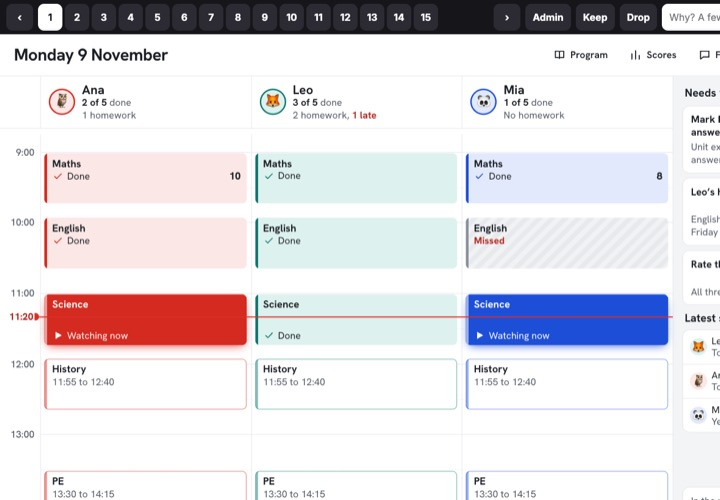 | **Round 1: 15 directions** · `/pad-lab/` · Sample Calendar day, family wall, needs-you inbox, one next thing, magazine front, child cards, day timeline, big tiles, school digest, checklist, progress rings, paper register, week map, split view and calm minimal. Each has a keep or drop button and a reason box. |
| 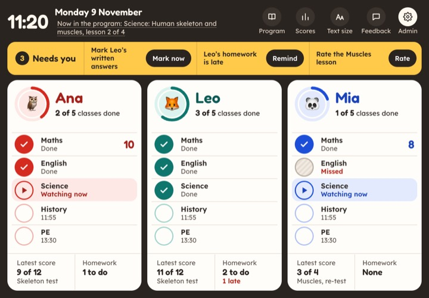 | **Family wall** · `/pad-lab/02-family-wall/` · Sample One big column per child, like a kitchen calendar. Kept from round 1. |
| 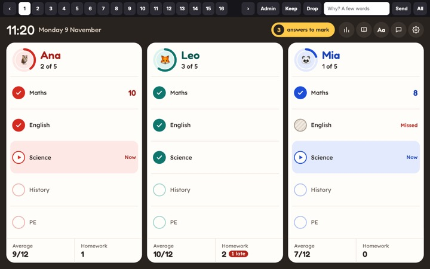 | **Round 2: 16 refined versions** · `/pad-lab/round2/` · Sample The kept ideas from round 1, mixed and made clearer: walls, cards, tiles, rings, checklists. |
| 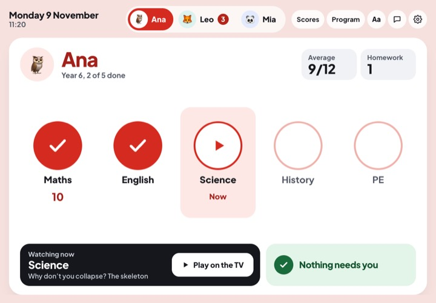 | **One child at a time** · `/pad-lab/round2/r04-cards-one/` · Sample One big card per child; tap a face or swipe to switch. |
| 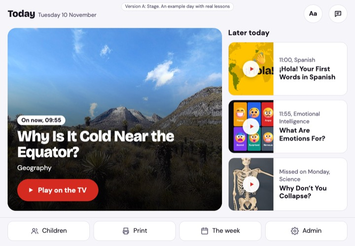 | **Round 3 A: Stage** · `/pad-lab/round3/a-stage/` · **Live** The pad has one job: put today's lesson on the TV. The lesson on now fills the screen; later lessons wait on the right. This became the real Today screen. |
| 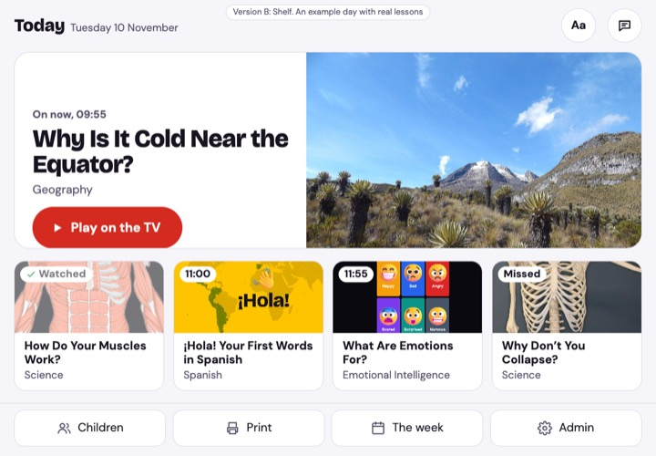 | **Round 3 B: Shelf** · `/pad-lab/round3/b-shelf/` · Sample One big banner for the lesson on now, then a shelf of picture cards. |
| 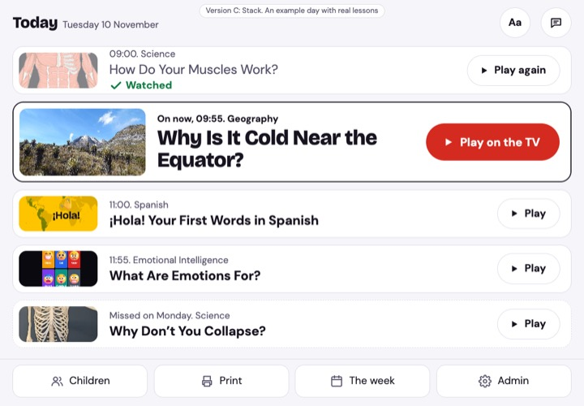 | **Round 3 C: Stack** · `/pad-lab/round3/c-stack/` · Sample Today's lessons one under another, each with its own Play; the one on now is biggest. |

## Children page
What each child is doing today, for the parent. Built from four questions: is each child doing school, what did they do and how did it go, does anyone need me, what's next.

| | |
|---|---|
| 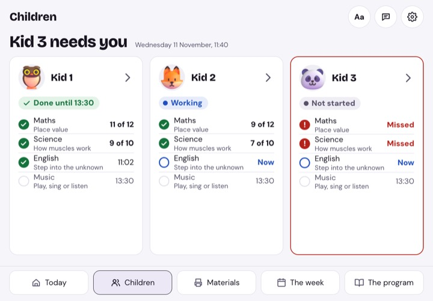 | **1. One card per child** · `/children-lab/view.html#a-3` · Sample, the direction picked Each card answers all four questions. One state word per child, missed classes in red. |
| 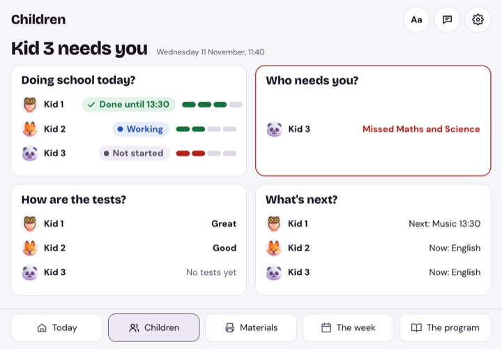 | **2. By question** · `/children-lab/view.html#b-3` · Sample Four answers, each showing every child. A third version, **Needs you first**, is at `#c-3`. Each opens with three or six children; the first also with one, two or four. |

## Materials
Pages to print, made from the week's lessons. Six directions in two rounds.

| | |
|---|---|
| 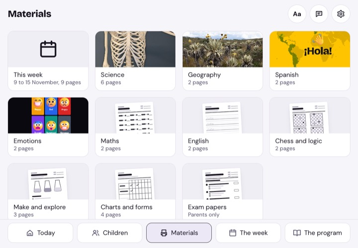 | **F. Categories, gallery, page** · `/materials-lab/f-gallery/` · **Live** Every category as an equal card; a category opens as a gallery; a page opens on the right with the others listed on the left. This is the app's Materials page. |
| 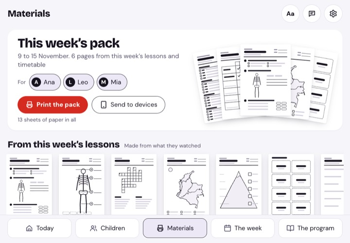 | **A. Shelves** · `/materials-lab/a-shelves/` · Sample The week's pack on top, then shelves of pages. |
| 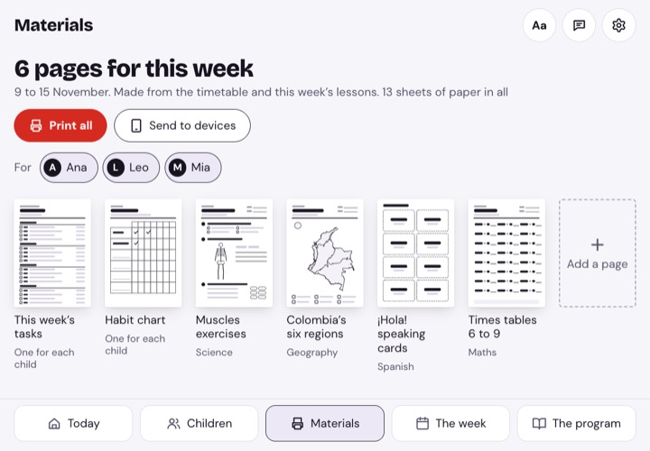 | **B. This week's bag** · `/materials-lab/b-week-bag/` · Sample The week's pages first, large and in order, with Print all. Also in the lab: **C. Subjects**, **D. This week first** and **E. This week as a card**, at `/materials-lab/`. |

## Child's screens
| | |
|---|---|
| 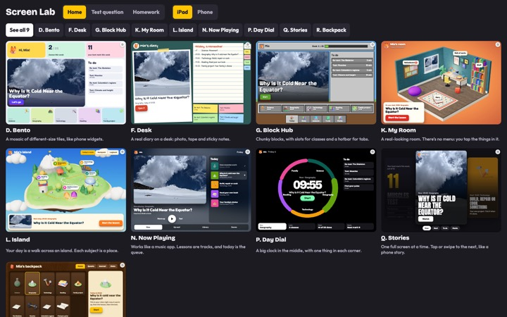 | **Screen Lab** · `/kid-lab/` · Sample Nine looks for the child's day, side by side at real tablet and phone sizes: Bento, Desk, Block Hub, My Room, Island, Now Playing, Day Dial, Stories and Backpack. The 3D art is rendered once to pictures (`tools/kid-art/`), so tablets need no 3D. |

## Child themes
Each child picks a look in their settings. 14 themes change colour, shape and type; the layout stays the same. Each is original, in the spirit of a kind of game, with no copied art, names or logos. **Live.**

| | | |
|---|---|---|
| 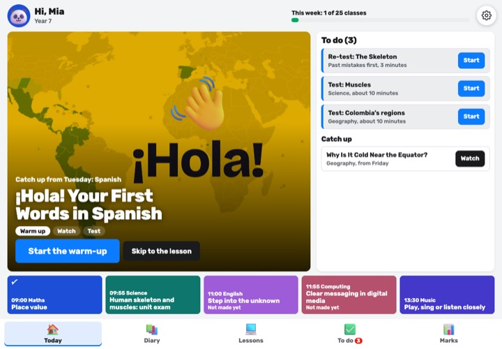 **Brick Studio** | 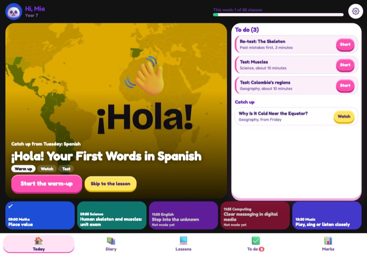 **Bubble Run** |  **Island Life** |
| 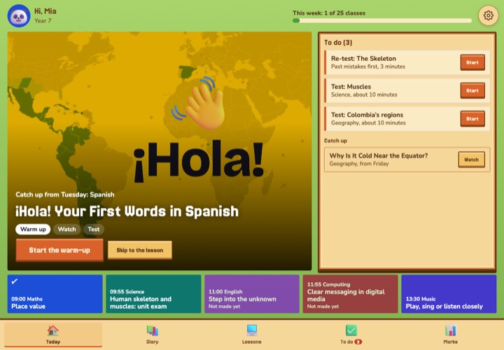 **Harvest Valley** | 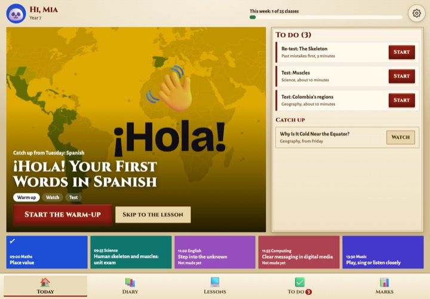 **Ancient Realm** | 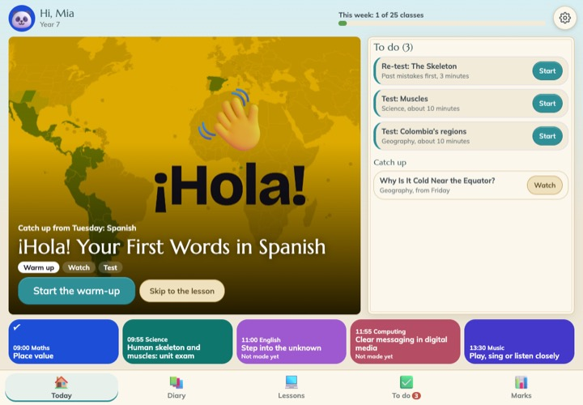 **Sky Journal** |

The others: Block Craft, Deep Mine, Space Crew, Storm Season, Toy Arena, Hero Academy, Home School TV (the first look) and Clean. All are in `channel/views/themes.js`.

## Theme kit
| | |
|---|---|
| 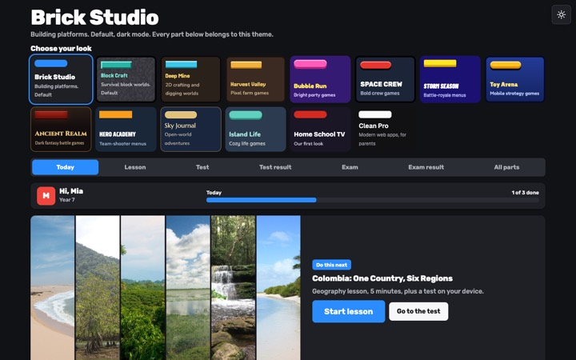 | **Theme Kit** · `/theme-kit/` · Reference Every part of the child's interface (Today, lesson, test, test result, exam, exam result) in each theme, to check that a theme works everywhere before a child picks it. |

## Older experiments
Kept as a record, not to build on: `channel/round1/` (the first design round), `channel/test-styles/` (early test looks), `channel/game/` (a game-style map), `channel/layouts/` (plain layouts for checking reading order) and `prototype/` (the very first prototype, with Book, Map and Channel looks).
